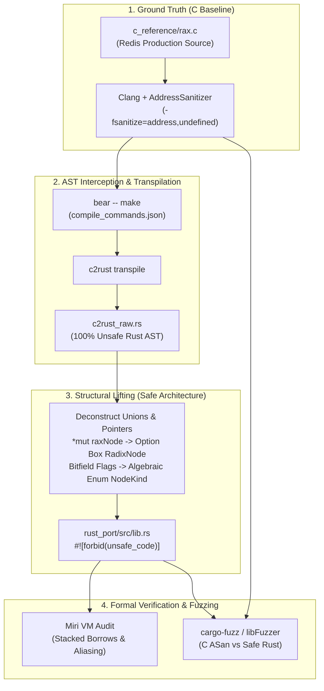
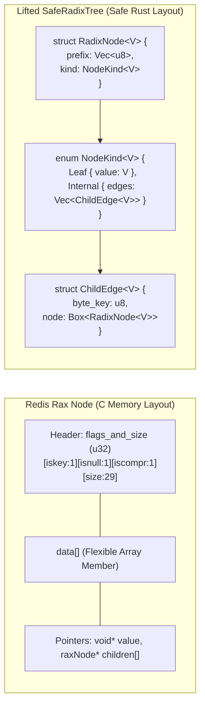
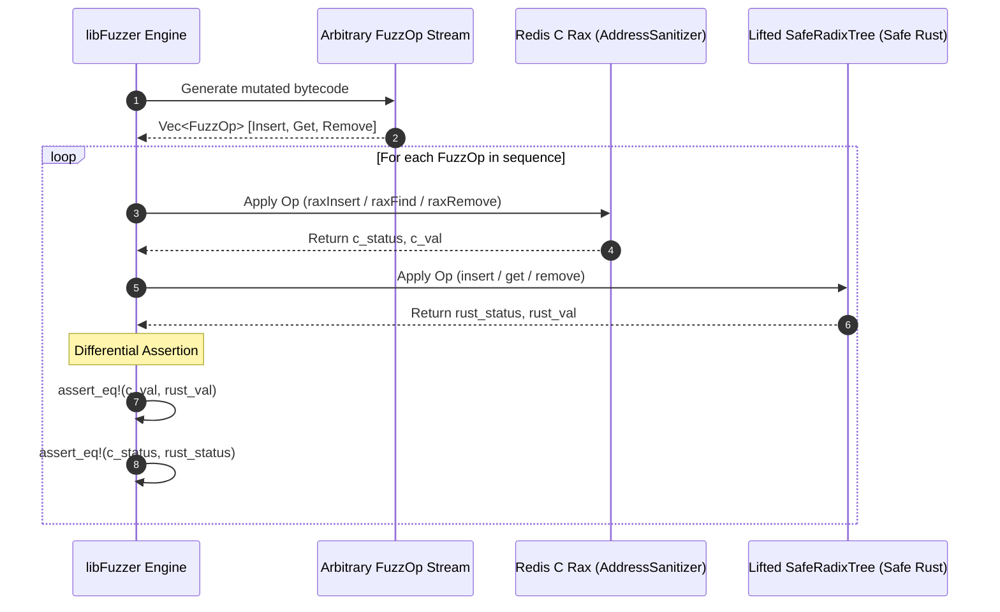

# safe-radix-kv

Port and formal verification of Redis's production Radix Tree (**Rax**, Salvatore Sanfilippo) to 100% Safe Rust (`#![forbid(unsafe_code)]`), validated with **Miri** and **Differential Fuzzing**.

[](https://www.rust-lang.org/)
[](https://github.com/rust-secure-code/safety-dance)
[](https://github.com/rust-lang/miri)
[](https://github.com/rust-fuzz/cargo-fuzz)

---

## Table of Contents
- [Executive Summary & Problem Statement](#executive-summary--problem-statement)
- [Real-World Production Context (AI & In-Memory Systems)](#real-world-production-context-ai--in-memory-systems)
- [The C2Rust Dilemma & The Lifting Pipeline](#the-c2rust-dilemma--the-lifting-pipeline)
- [Structural Lifting: From C Pointers to Safe Rust](#structural-lifting-from-c-pointers-to-safe-rust)
- [Verification & Quality Architecture](#verification--quality-architecture)
  - [Miri Formal Verification (Stacked Borrows)](#miri-formal-verification-stacked-borrows)
  - [Differential Fuzzing (C ASan vs Safe Rust)](#differential-fuzzing-c-asan-vs-safe-rust)
- [Repository Structure](#repository-structure)
- [Getting Started & Verification](#getting-started--verification)
  - [Building and Running Safe Rust Tests](#building-and-running-safe-rust-tests)
  - [Running Miri Undefined Behavior Audit](#running-miri-undefined-behavior-audit)
  - [Running Differential Fuzzing](#running-differential-fuzzing)

---

## Executive Summary & Problem Statement

Radix Trees (compact prefix tries) are the foundational indexing structures behind in-memory databases, lexical search engines, and LLM inference engines. Salvatore Sanfilippo's **`rax`** is the battle-tested ANSI C radix tree powering Redis streams, cluster routing, and command dispatching. 

While extraordinarily memory-efficient and fast, `rax.c` achieves performance through techniques that are notorious vectors for memory corruption:
- **Bitfield-packed node headers** (`iskey:1`, `isnull:1`, `iscompr:1`, `size:29`).
- **Flexible array members** storing dynamically sized arrays of characters followed directly by unaligned pointer tables.
- **Manual dynamic reallocations** (`malloc`, `realloc`, `free`) with pointer arithmetic and `void*` payloads.

Converting such pointer-dense, self-referential structures to Rust is considered one of the hardest challenges in systems engineering (the central goal of initiatives like DARPA TRACTOR).

---

## Real-World Production Context (AI & In-Memory Systems)

This architecture directly addresses two core production workloads in state-of-the-art AI infrastructure:

1. **Hybrid Search Engines (BM25 + Dense Vectors):** Vector databases like **Qdrant** and **Vespa** combine approximate nearest neighbor graphs (HNSW) with memory-resident inverted indexes. Radix trees provide sub-millisecond prefix lookup for sparse token vocabularies.
2. **LLM KV-Cache & RadixAttention:** Advanced LLM serving engines (such as **vLLM** and **SGLang**) use radix trees to manage token KV-cache hierarchies across concurrent requests. Common prefix trees allow instant context reuse across system prompts and conversation branches.

---

## The C2Rust Dilemma & The Lifting Pipeline

Automated transpilers like `c2rust` mechanically map C syntax to Rust, but produce code that is **100% `unsafe`**, full of raw pointers (`*mut T`), `libc::malloc`, and explicit pointer casts. This provides zero memory safety benefits.

`safe-radix-kv` showcases the end-to-end **Lifting Pipeline**: translating transpiled unsafe code into idiomatic, compile-time verified Safe Rust under `#![forbid(unsafe_code)]`.



---

## Structural Lifting: From C Pointers to Safe Rust

The table below contrasts the low-level C memory layout of Redis's `rax` against the lifted Safe Rust design:

| Redis `rax` (C) | Lifted `SafeRadixTree` (Safe Rust) | Architectural Advantage |
| :--- | :--- | :--- |
| `raxNode *` (Raw nullable pointer) | `Option<Box<RadixNode<V>>>` | Compile-time guaranteed null safety; automatic recursive RAII deallocation without `free()`. |
| Bitfields: `iskey:1, isnull:1, iscompr:1` | `enum NodeKind<V> { Leaf { value }, Internal { edges } }` | Impossible to represent invalid states; discriminated by compiler-checked algebraic types. |
| Flexible array: `raxEdge*` with `realloc()` | `Vec<ChildEdge<V>>` | Bounds-checked dynamic growth without buffer overflow risk or memory fragmentation. |
| Status codes: `1 (ok), 0 (oom), NULL (not found)` | `Result<Option<V>, RadixError>` | Explicit domain error modeling using `thiserror`. |
| Pointer casts: `(void*)data` | Generic type parameter `V` | Type-safe value storage with compile-time monomorphization and zero runtime casting overhead. |

### Memory Representation Comparison



---

## Verification & Quality Architecture

Migrating mission-critical infrastructure demands formal proof that the new implementation introduces no regressions, memory leaks, or subtle semantic shifts.

### 1. Miri Formal Verification (Stacked Borrows)
Running `cargo +nightly miri test` executes the test suite inside an interpreter that tracks the provenance and allocation boundaries of every single byte:
- Proves the absolute absence of **Undefined Behavior (UB)**.
- Validates that the tree traversal satisfies Rust's strict **Stacked Borrows** aliasing model.
- Verifies that recursive node deallocations leave zero memory leaks.

### 2. Differential Fuzzing (C ASan vs Safe Rust)

A continuous fuzzing harness (`fuzz/fuzz_targets/diff_c_vs_rust.rs`) submits randomized operation streams simultaneously to both implementations:



Any discrepancy in prefix splitting, compressed node handling, or memory access triggers an immediate reproducible crash artifact.

---

## Repository Structure

```text
safe-radix-kv/
├── Dockerfile                  # Clang, Bear, C2Rust, Rust Nightly, Miri, Cargo-Fuzz
├── c_reference/
│   ├── Makefile                # Build with AddressSanitizer and UndefinedBehaviorSanitizer
│   ├── rax.h                   # Official Redis Rax header
│   ├── rax.c                   # Official Redis Rax implementation
│   ├── rax_malloc.h            # Memory allocator abstraction
│   └── main_test.c             # C integration test suite
├── rust_port/
│   ├── Cargo.toml              # Rust library configuration
│   └── src/
│       ├── c2rust_raw.rs       # Unsafe transpilation baseline (historical reference)
│       └── lib.rs              # Lifted 100% Safe Rust Radix Tree (#![forbid(unsafe_code)])
└── fuzz/
    ├── Cargo.toml              # cargo-fuzz & libfuzzer-sys configuration
    └── fuzz_targets/
        └── diff_c_vs_rust.rs   # Differential fuzzing harness (C vs Safe Rust)
```

---

## Getting Started & Verification

### Prerequisites
- Clang / GCC with AddressSanitizer support
- Rust Nightly (`rustup default nightly && rustup component add miri`)
- `cargo-fuzz` (`cargo install cargo-fuzz`)

### Building and Running Safe Rust Tests
```bash
cd rust_port
cargo test
```

### Running Miri Undefined Behavior Audit
```bash
cd rust_port
cargo +nightly miri test
```

### Running Differential Fuzzing
```bash
cd fuzz
cargo fuzz run diff_c_vs_rust -- -max_total_time=300
```
